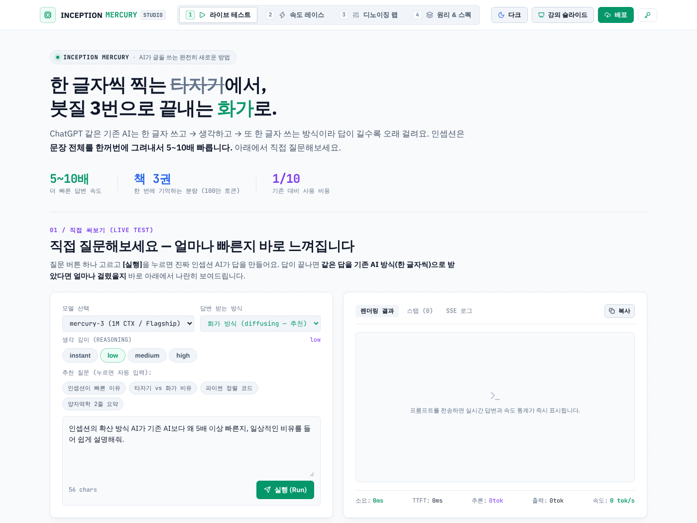
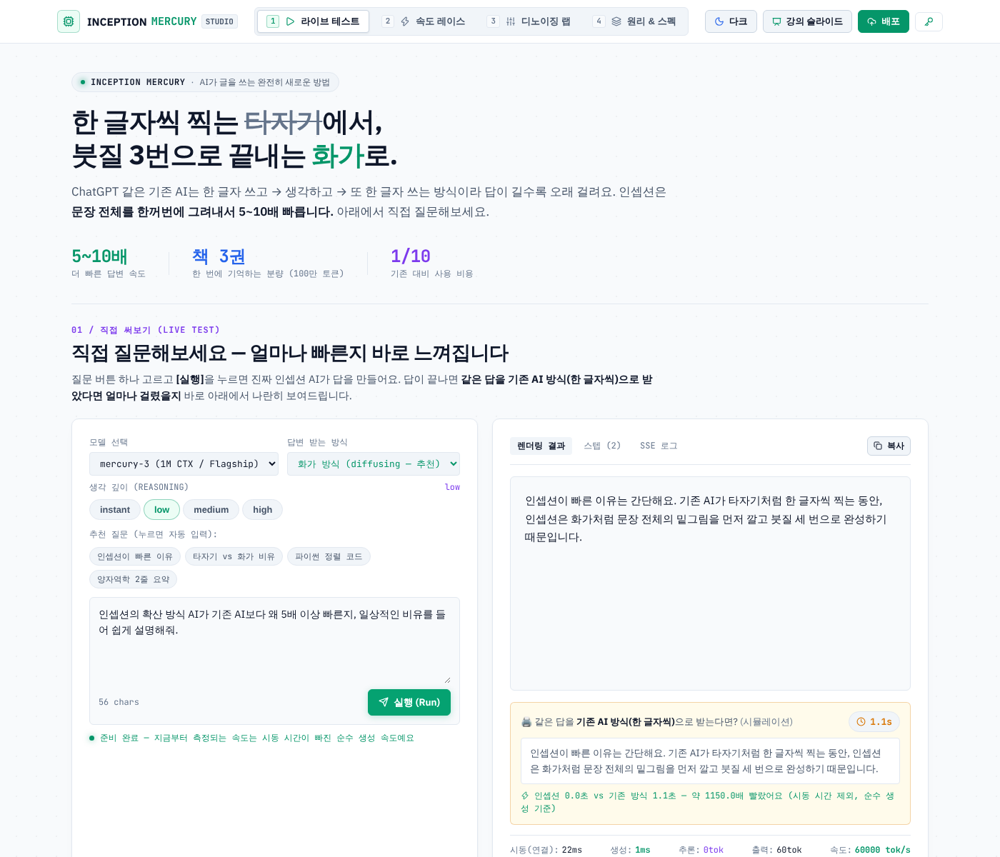
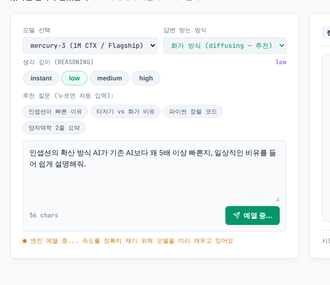
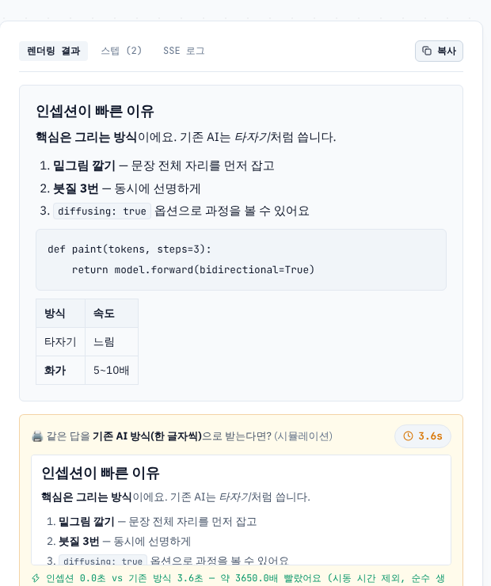
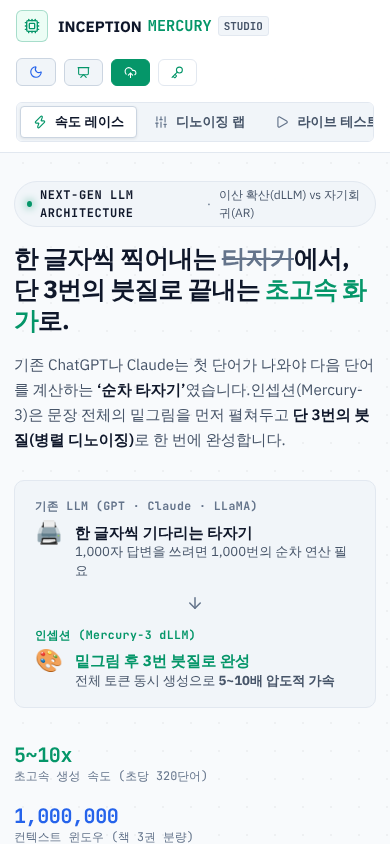
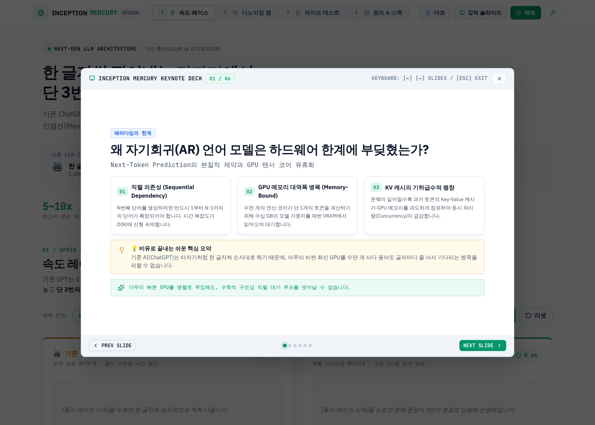

> 🔗 **직접 써보기:** https://inception-mercury-studio.vercel.app
> 💻 **코드:** https://github.com/cdsassj00/inception

## 들어가며: 설명보다 체험

요즘 강의에서 가장 많이 받는 질문 중 하나가 "확산(디퓨전) 방식 언어 모델이 뭐가 다른데요?"입니다.
말로 설명하면 어렵습니다. 자기회귀, 병렬 디노이징, 양방향 어텐션… 듣는 사람은 벌써 눈이 감깁니다.

그래서 비유를 하나 정했습니다.

- **기존 AI(ChatGPT 등) = 타자기.** 한 글자 쓰고 → 생각하고 → 또 한 글자. 답이 길수록 오래 걸립니다.
- **인셉션(Mercury) = 화가.** 문장 전체의 밑그림을 먼저 깔고, 붓질 세 번으로 한꺼번에 완성합니다.

이 비유를 **설명이 아니라 체험으로** 전달하는 사이트가 *Inception Mercury dLLM Studio*입니다.
React 19 + Vite로 만든 단일 페이지 앱이고, Vercel에 올라가 있습니다.



## 원래 사이트의 문제

첫 버전은 기능은 다 있었는데, 막상 수강생에게 보여주려니 세 가지가 걸렸습니다.

1. **너무 어려웠다.** 첫 화면부터 "이산 확산(dLLM) vs 자기회귀(AR)", "O(N) 순차 지연", "Memory-Bound 병목" 같은 말이 쏟아졌습니다. 수학자·과학자용 설명 같았습니다.
2. **글이 너무 많았다.** 히어로 영역에 문단이 세 개, 비교 박스, 통계까지. 스크롤을 한참 내려야 뭔가 눌러볼 수 있었습니다.
3. **라이트 모드가 깨져 있었다.** 다크 모드 기준으로 만들다 보니 모달 제목이 흰 글자로 하드코딩돼 밝은 배경에서 아예 안 보였고, API 키 입력창 글자도 흰색이었습니다. JSX에서 쓰는 CSS 클래스(`p-4`, `mt-3`, `d-none-mobile` 등) 상당수가 정의조차 안 돼 있어서 모달 패딩이 0이고 모바일 대응도 사실상 없었습니다.

## 고친 것 1 — 라이브 테스트를 첫 화면으로

가장 큰 결정은 **탭 순서를 바꾼 것**입니다.
원래는 "속도 레이스 → 디노이징 랩 → 라이브 테스트 → 원리"였는데, 라이브 테스트를 맨 앞으로 끌어왔습니다.
들어오자마자 질문 버튼 하나 고르고 실행을 누르면 **진짜 인셉션 API**가 답을 만듭니다. 원리 설명은 그 뒤에 있어도 늦지 않습니다.

히어로도 과감히 줄였습니다. 헤드라인 한 줄, 쉬운 말로 쓴 리드 한 문장, 숫자 세 개. 끝.

> 한 글자씩 찍는 ~~타자기~~에서, 붓질 3번으로 끝내는 **화가**로.

## 고친 것 2 — "기존 AI였다면?" 비교 패널

빠르다는 말은 비교 대상이 있어야 와닿습니다.
그래서 인셉션 답변이 끝나는 순간, **같은 답을 기존 AI 타자기 속도(초당 약 80자)로 다시 재생하는 패널**을 아래에 붙였습니다.



- 인셉션은 이미 끝났는데 아래 패널은 아직 타이핑 중인 모습이 핵심입니다.
- 타이머가 돌고, 끝나면 "인셉션 1.2초 vs 기존 방식 11.3초 — 약 9배" 식으로 결론이 나옵니다.
- 기다리기 지루하면 "건너뛰기"를 누르면 됩니다.

구현은 단순합니다. 응답 전체 텍스트를 받아 `setInterval`로 50ms마다 4글자씩 잘라 보여주고, 끝나면 경과 시간을 기록합니다.
시뮬레이션이라는 점은 패널 제목에 명시했습니다. 숫자가 정직해야 강의에서 쓸 수 있으니까요.

## 고친 것 3 — 시동 시간은 속도에서 빼자

실제로 써보니 첫 실행 때 몇 초간 멈추는 구간이 있었습니다. 모델이 깨어나는 콜드 스타트입니다.
이게 "생성 속도"에 섞이면 비교가 왜곡됩니다. 두 가지로 처리했습니다.



1. **자동 예열.** 라이브 테스트 화면에 들어오면 1토큰짜리 초소형 요청을 미리 보내 모델을 깨웁니다. 예열이 끝날 때까지 실행 버튼은 "예열 중…"으로 잠깁니다. 페이지당 한 번만 합니다(탭을 오가도 다시 안 함).
2. **시동/생성 분리 측정.** 첫 바이트가 올 때까지를 "시동(연결)", 그 이후를 "생성"으로 나눠 표시하고, tok/s와 "N배" 비교는 **순수 생성 시간**으로만 계산합니다.

```js
// 첫 바이트 이후만 생성 시간으로 친다
const genMs = firstTokenTime > 0 ? totalMs - firstTokenTime : totalMs;
const tps = Math.round(outTokens / (genMs / 1000));
```

## 고친 것 4 — 마크다운 렌더링

LLM 답변은 `**굵게**`, 리스트, 코드블록, 표가 섞여 나오는데 처음엔 그냥 텍스트로 찍혔습니다.
`react-markdown` + `remark-gfm`으로 바꿨습니다. HTML은 기본적으로 차단되니 안전하고, 디자인 토큰에 맞춰 제목·코드·표 스타일만 얹었습니다.



재미있는 디테일 하나: 아래 "기존 AI 방식" 패널은 **타이핑 중에는 날것 그대로**(타자기 느낌), 끝나면 마크다운으로 정리됩니다.

## 고친 것 5 — 쉬운 말로 전부 다시 쓰기

문구를 통째로 다시 썼습니다. 원칙은 하나였습니다. **비유 먼저, 전문용어는 괄호 안에.**

| 전 | 후 |
|---|---|
| 순차 생성 $O(N)$ · 글자 수만큼 시간 증가 | 한 글자씩 차례로 · 글자 수만큼 기다림 |
| 병렬 디노이징 $O(1)$ · 고정 3스텝 | 문장 전체를 동시에 · 붓질 3번이면 완성 |
| REASONING EFFORT | 생각 깊이 (REASONING) |
| 디노이징 스크러버: 3단계 붓질로… | 흐릿한 글자가 3번 만에 선명해지는 과정을 직접 돌려보세요 |

"원리 & 스펙" 탭은 개발자·연구자용 **심화** 섹션이라고 명시해 두고, 거기엔 원래의 기술 내용을 남겼습니다. 설명은 모아두되, 첫 화면에는 안 보이게.

## 고친 것 6 — 깨진 UI 수리

- 하드코딩된 흰색/검정 색상을 전부 테마 변수로 → 라이트 모드에서 글자가 보입니다.
- 미정의 유틸 클래스 구현 → 모달 패딩·여백 복원, 키노트의 "비유로 끝내는 핵심 요약" 콜아웃이 드디어 콜아웃처럼 보입니다.
- 모바일: 1080px 이하에서 탭 내비가 가로 스크롤 행으로 분리, 720px 이하에서 라벨 숨김.
- 저장된 테마를 첫 페인트 전에 적용해 라이트↔다크 깜빡임 제거.





## 검증과 배포

- 모든 변경은 Playwright로 라이트/다크 × 데스크톱/모바일 스크린샷을 찍어 확인했습니다.
- API 호출은 Playwright의 `page.route()`로 가짜 SSE 응답을 돌려줘서 **크레딧을 쓰지 않고** 비교 패널·예열·마크다운을 테스트했습니다.
- Vercel에 프로덕션 배포. 번들 해시를 curl로 확인해 반영 여부를 검증했습니다.

## 배운 것

1. **"쉽게"는 톤이 아니라 구조다.** 문장을 순화하는 것보다 탭 순서를 바꾸고 히어로를 반으로 자른 게 훨씬 효과가 컸습니다.
2. **비교는 같은 화면 안에서.** 다른 탭의 시뮬레이션보다, 방금 받은 진짜 답을 그 자리에서 느리게 다시 보여주는 게 훨씬 직관적이었습니다.
3. **측정은 정직하게 쪼개라.** 콜드 스타트를 빼지 않으면 "빠르다"는 주장 자체가 흔들립니다.
4. **다크 모드 먼저 만들면 라이트 모드는 반드시 깨진다.** 색은 처음부터 토큰으로.

---

*사이트: https://inception-mercury-studio.vercel.app · 코드: https://github.com/cdsassj00/inception*
